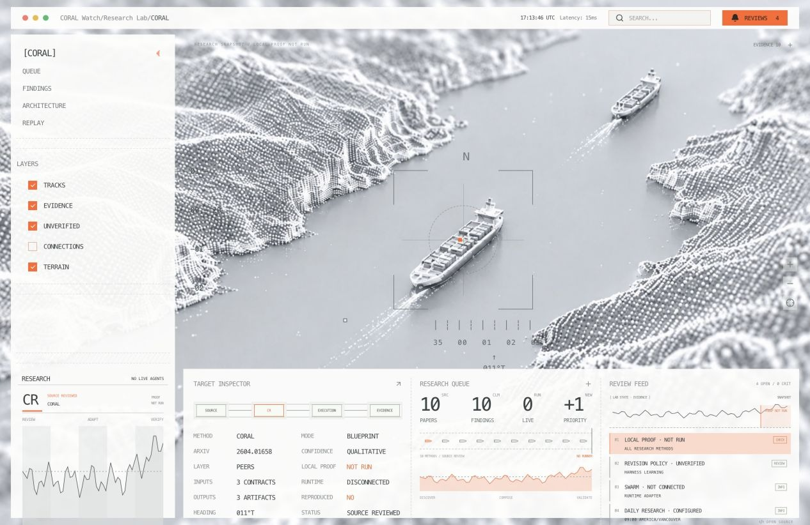

# CORAL Research Lab

A monochrome research console for discovering algorithms, composing papers, designing an agent lab, and inspecting evidence. Orange instrument overlays sit over a generated point-cloud strait. The console adapts a supplied visual reference to research workflows.



## Run locally

Requires Node.js 22.13 or newer and npm. No model API key is needed for the included research workbench.

```sh
npm install
npm run db:init
npm run dev -- --host 127.0.0.1 --port 5198
```

Open `http://127.0.0.1:5198`. Local development provides local SQLite/D1 storage. If an authenticated storage session is unavailable, the workbench uses a validated browser-local workspace and reports that storage mode. Local authentication emulation is not production authentication.

```sh
npm run typecheck
npm test
npm run build
```

## What works

- Select research methods on the map and inspect their artifact contracts and proof state.
- Toggle visual layers, zoom, and reset the view.
- Search arXiv/Crossref, import papers, and save a research library.
- Compose 2–8 methods into a hypothesis with interfaces, gaps, and proposed experiments.
- Edit the lab charter, module choices, resources, and source registry; export a blueprint.
- Inspect source-supported findings with separate mechanism confidence and expected local benefit.
- Replay and export retained research events.
- Save and restore an owner-scoped workspace.

Open **Queue → Search new papers / Compose methods / Edit architecture** for the research workbench. The header search also opens discovery.

## Research versus runtime

This release is a functional research dashboard and architecture workbench. A live agent swarm, experiment executor, and scheduler are not connected. The map is a method visualization, and its waveform is explicitly illustrative. Counts come from the bundled research catalogue and evidence. Findings retain `not_run` until measured evidence exists.

The curated methods include CORAL, Dream-RSI, SIFT, DGM, GEPA, ACE, ReasoningBank, OpenHands, Terminal-Bench, and [Harness Learning](https://arxiv.org/abs/2609.35738). Method composition is an interface hypothesis, not an automatically validated scientific result.

## Architecture

- `app/console/`: instrument console, target selection, evidence inspector, and trace playback.
- `app/dashboard.tsx`: discovery, composition, architecture editor, and workspace interactions.
- `app/api/`: same-origin research, import, composition, health, and workspace endpoints.
- `lib/`: typed research methods, contract composition, scholarly clients, and validation.
- `db/` and `drizzle/`: owner-scoped workspace storage and schema.
- `public/research/`: curated findings and observable research events.
- `public/assets/`: generated terrain artwork and attribution.

The backend runs on Cloudflare Workers through the retained Vinext/Sites starter. For hosting, provision your own D1 database and authentication boundary. `.openai/hosting.json` in the public release is a local configuration, not a credential or an existing hosted Site. Never accept identity headers directly from an untrusted public client; a trusted authenticated gateway must set them.

## Extend the lab

Connect a runtime by replacing the static research-unit adapter with a versioned read-only snapshot of peers, projects, attempts, and resource state. Keep executable changes behind authenticated server actions. Protect evaluators and permissions outside mutable agents. Ingest findings only with source references, explicit proof states, reproduction receipts, and trace lineage. Avoid turning displayed activity into evidence of improvement.

## Contributing

Keep components focused and typed. Include a screenshot for visual changes and a focused check for changed behavior. Preserve the distinction between source claims and measured local outcomes. Do not commit credentials, database state, personal workspace exports, or local scheduler/chat identifiers. This repository does not enable GitHub Actions; checks run locally.

## License and sources

Project code is MIT licensed. Dependency licenses remain with their respective authors. Generated artwork is documented in `public/assets/ATTRIBUTION.md`. Paper titles, citations, and research claims retain attribution to their primary sources. The public release excludes copied third-party full-text snapshots and all private deployment identity, workspace databases, chat history, and automation configuration.
